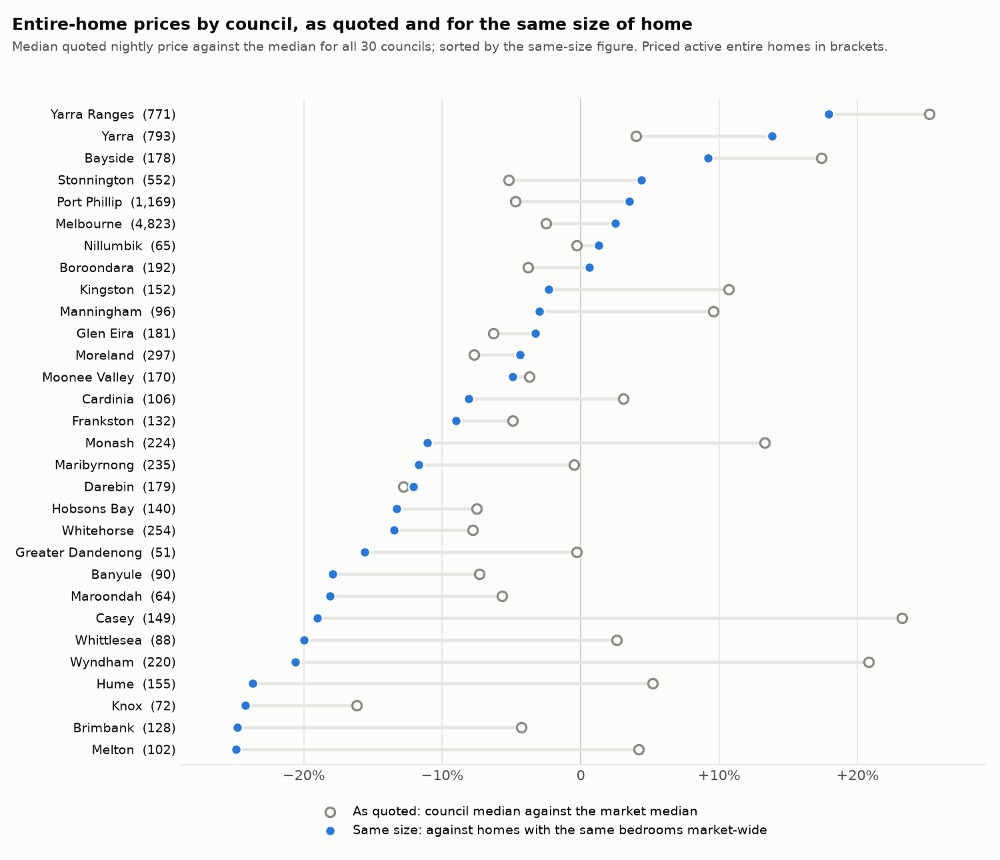

# Melbourne's short-term rental market: pricing, hosts and homes taken off the rental market

[](https://github.com/nisha1324/melbourne-short-term-rentals/actions/workflows/ci.yml)

**Status: work in progress (Parts 1-3 of 5 done).**

Melbourne's Airbnb snapshot lists over 25,000 places to stay, and a common question in housing debates is how
many of them are homes that would otherwise be rented to people who live here. Property managers and
investors ask the other side of the same question: what does a short-stay listing earn against a long-term lease?

This project reads the public listing data as a **council housing team, a property manager or an investor** would:
how big the market really is, what listings charge, who runs them, and how many look like full-time rentals taken
off the long-term market. It is SQL (DuckDB) and Python on real public data, with no machine learning. It links to
[`vic-rental-market-analysis`](https://github.com/nisha1324/vic-rental-market-analysis), which covers long-term rents.

## The data

- **Source:** [Inside Airbnb](https://insideairbnb.com/get-the-data/), Melbourne, Victoria, snapshot of
  16 September 2026 (scraped 17-18 September 2026). Licence: CC BY 4.0. Inside Airbnb collects public Airbnb
  listing pages; it is not associated with Airbnb.
- **Files used** (SHA-256 pinned in [`str_market/source.py`](str_market/source.py), download details in
  [`data/SNAPSHOT.json`](data/SNAPSHOT.json)): the detailed listings (25,715 listings), the 365-day calendar
  (9,385,976 listing-days), the date of every review (1,042,226 reviews) and the 30 council (LGA) boundaries.
  The detailed review file, which holds review text and reviewer names, is not downloaded.
- **Nothing listing-level is committed.** Inside Airbnb's [community guidelines](https://insideairbnb.com/data-policies/)
  ask users to take only the data they need, to download it once rather than on every run, and not to republish
  it. So `scripts/download_data.py` fetches the four files once into `data/raw/` (gitignored), and only
  aggregated results are committed. Host names, profile text and descriptions are dropped at load, and no result
  names a host.
- **Citation:** Inside Airbnb. (2026). *Melbourne Airbnb listings data, September 2026* [Data set].
  https://insideairbnb.com/get-the-data/

## Roadmap

| Part | What | Status |
| --- | --- | --- |
| 1 | **Source, snapshot and data profile**: which listings count as the active market, 20 data-quality checks, room types, prices, councils, minimum stays and a first look at hosts | done: [`results/PROFILE.md`](results/PROFILE.md) |
| 2 | **Pricing**: what a night costs by size and council, size for size; how stay length, weekends and Grand Final weekend move the price; a council × size price guide; and how homes priced well above or below similar ones fare | done: [`results/PRICING.md`](results/PRICING.md) |
| 3 | **Host concentration**: how much of the market multi-listing operators run, council by council, how they compare with one-listing hosts, and what a typical operator's portfolio looks like (no host named) | done: [`results/HOSTS.md`](results/HOSTS.md) |
| 4 | **Homes off the long-term market**: entire homes that are open most of the year and booked often enough to look like full-time short-stay rentals, by council, with their estimated earnings set against long-term rents | next |
| 5 | **Summary**: findings, ranked recommendations and limits | planned |

## Part 1 findings

Full report: [`results/PROFILE.md`](results/PROFILE.md).

- **The headline count overstates the market by about two-thirds.** The snapshot has 25,715 listings, but only
  **15,595** (from 7,562 hosts) had a review in the 12 months to the scrape, the definition of "active" used
  from here on. 6,843 listings were carried over from earlier scrapes and look dormant (6,144 have no open night
  in the next year; their median last review is March 2023).
- **It is an entire-home market.** 82.3% of active listings are entire homes or apartments, with a median quoted
  price of $300 a night ($230 to $398 for the middle half); a private room's median is $107.
- **It is concentrated in the inner city.** The City of Melbourne alone has 36.6% of active listings, and with
  Port Phillip and Yarra the three inner councils have 52.5%. Yarra Ranges is fourth, almost all entire homes.
- **Most listings take short stays.** 82.6% accept one or two nights; only 123 (0.8%) need 28 nights or more.
- **Multi-listing hosts run most of it.** Hosts with two or more active listings have 63.1% of them, and 192 hosts
  with 10 or more have 30.8%.
- **The data checks out.** 14 of 20 quality checks pass outright; review counts, first and last review dates and
  12-month review counts reconcile exactly with the review file. Two small calendar mismatches (13 listings) and
  four information-only counts are explained in the report.


## Part 2 findings: pricing

Full report: [`results/PRICING.md`](results/PRICING.md). It covers the 11,828 active entire homes with a quoted
price and a bedroom count. Each home is compared with its **peers**: active entire homes in the same council with
the same number of bedrooms (groups of 10 or more, which hold 98.2% of the homes).

- **Raw council medians mislead.** Ranked by their own medians, Casey and Wyndham are the 2nd and 3rd dearest of
  30 councils, because their homes are bigger (a median 4 bedrooms). Size for size they price 19.0% and 20.6%
  below the market and rank 24th and 26th. Stonnington and Port Phillip go the other way (22nd → 4th and
  20th → 5th). An investor comparing suburbs should compare homes of the same size; the repo includes a price guide
  for 128 council × size groups (`results/peer_price_guide.csv`).
- **Bigger homes cost more a night but less per guest.** The median quote rises from $229 for 1 bedroom to $309
  for 2 and $425 for 3, while price per guest falls from $112 (homes taking 1-2 guests) to $50 (9 or more).
- **Long stays are discounted.** Against their peers, quotes for 7-27 nights are 12.7% below and quotes for
  28 nights or more 38.6% below.
- **Grand Final weekend was mostly gone about a week out.** Only 14.6% of homes still had the Friday or Saturday of
  25-26 September 2026 open, against 39.9% the weekend after. Short stays covering those nights quoted 26.4%
  above peers (different listings, so consistent with event pricing rather than a measure of it). How far ahead a
  stay starts makes little difference otherwise.
- **Homes priced well above their peers show fewer stays.** The 10.1% priced 50% or more above their peers have a
  median of 7 reviews in the year against 12 for homes within 10%, and 15 of the next 30 nights open against 12,
  though they are rated slightly higher. Whether the higher price makes up for it is Part 4's question.



## Part 3 findings: who runs the market

Full report: [`results/HOSTS.md`](results/HOSTS.md). A host is one Airbnb account (so this measures who runs
listings, not who owns the homes). Its size is its number of active listings across all 30 councils, and
**operators** are hosts with 10 or more.

- **No single host is big, but a tier of operators runs nearly a third of the market.** The largest host runs 0.7%
  of active listings and the largest 10 run 5.4%. Yet the 192 operators (2.5% of hosts) run 30.8% of listings
  (34.1% of entire homes), and 841 hosts run half.
- **The mix depends on the council.** Operators run 46.5% of the City of Melbourne's listings, and 160 of the 192
  have a listing there, but 11.3% of Yarra Ranges' and 4.1% of Nillumbik's. In the City of Melbourne, rules on
  short stays would mostly land on a few hundred operators; in the outer and hills councils, on many small hosts.
  A council housing team should read its own row.
- **4,743 entire homes are run by a host with no other active listing**, the natural client pool for a property
  manager; 2,852 of them are in five councils (Melbourne, Port Phillip, Yarra, Yarra Ranges and Stonnington).
- **Scale does not seem to buy pricing power.** Size for size, every host-size group prices within 5% of its peers
  (one-listing hosts −2.9%, hosts with 50+ listings +4.4%), and reviews and open nights barely differ. Ratings fall
  with size, from a median 4.92 for one-listing hosts to 4.76 for hosts with 50+, and 26.3% of the largest hosts are
  Superhosts against 47.6% of one-listing hosts.
- **The typical operator** runs 17 active listings across 3 councils; 78.1% run nothing but entire homes, and
  89.6% have at least one listing in the City of Melbourne, Port Phillip or Yarra.
- **Inside Airbnb's own host counts run higher** (266 hosts with 10 or more listings, not 192) because they include
  dormant listings.


## How to run

Python 3.12.

```bash
python -m venv .venv && source .venv/bin/activate
pip install -r requirements-lock.txt      # exact versions the committed outputs were made with
python scripts/download_data.py           # once: ~66 MB into data/raw/, checked against the pinned hashes
python scripts/profile_report.py          # builds data/str_melbourne.duckdb, writes results/ (Part 1)
python scripts/pricing_report.py          # Part 2, from the same database
python scripts/hosts_report.py            # Part 3, from the same database
pytest -q
```

`python scripts/download_data.py --check` checks the files without touching the network.

**Tests.** The build and every query are tested on hand-made snapshots whose expected results are worked out
by hand (six listings for Part 1 in `tests/conftest.py`, twelve for Part 2 in `tests/test_pricing.py`, 79 from
eleven hosts for Part 3 in `tests/test_hosts.py`), so CI runs without downloading the data. With the real data
present, `tests/test_regenerate.py` also checks that all three reports, their CSVs and charts regenerate byte for
byte, and
`tests/test_readme.py` checks the figures in this README against the committed results.

## Repository layout

```
str_market/   source.py (URLs, pinned hashes), build.py (raw files -> DuckDB), profile.py (Part 1 queries),
              pricing.py (Part 2 thresholds and queries), hosts.py (Part 3 queries)
sql/          one file per query; active_listings.sql defines the active market used everywhere,
              priced_homes.sql the peer comparison used in Part 2, host_listings.sql the host sizes in Part 3
scripts/      download_data.py, profile_report.py, pricing_report.py, hosts_report.py
results/      PROFILE.md, PRICING.md, HOSTS.md, aggregated CSVs, charts/
tests/        fixture snapshot and tests
data/         SNAPSHOT.json (committed); raw/ and the DuckDB file are gitignored
```

## Limits (so far)

- One snapshot, so no change over time. Inside Airbnb supplies older snapshots on request; none were requested.
- "Active" is inferred from reviews, which miss stays where the guest left no review; the calendar cannot
  separate booked nights from nights the host blocked.
- Prices are quotes for each listing's next available stay (usually its minimum stay), not typical nightly rates,
  and the calendar carries no prices. So each listing has one price, and differences by date are differences
  between listings.
- Peers share a council and a bedroom count, not a street, view or fit-out.
- A host is an Airbnb account, not a company or an owner: one business may use several accounts, and a manager's
  account mixes homes from many owners.
- Inside Airbnb is an advocacy project as well as a data source. Everything here is recomputed from its raw files
  with the definitions in `sql/`, not taken from its dashboards.
