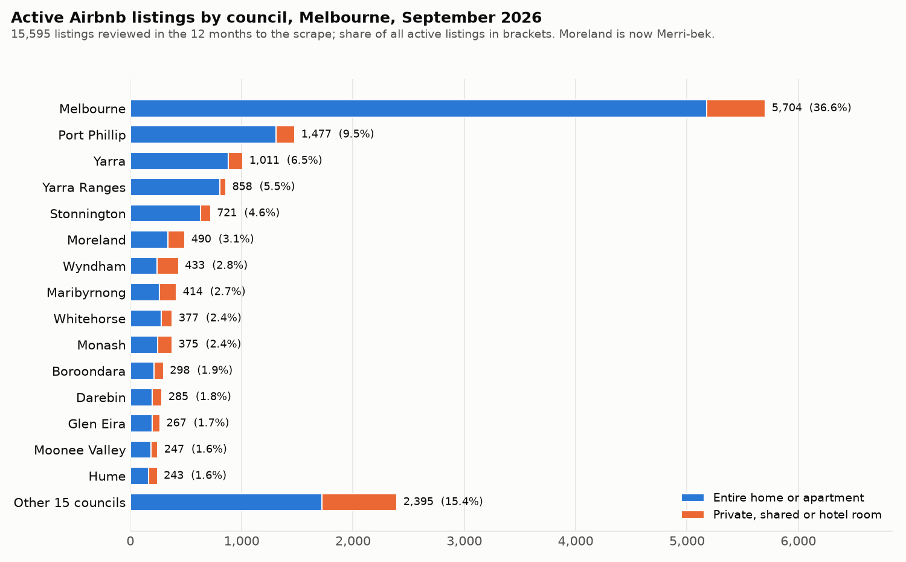

# Melbourne's short-term rental market: pricing, hosts and homes taken off the rental market

[](https://github.com/nisha1324/melbourne-short-term-rentals/actions/workflows/ci.yml)

**Status: work in progress (Part 1 of 5 done).**

Melbourne's Airbnb snapshot lists over 25,000 places to stay, and a common question in housing debates is how
many of them are homes that would otherwise be rented to people who live here. Property managers and
investors ask the other side of the same question: what does a short-stay listing earn against a long-term lease?

This project reads the public listing data as a **council housing team, a property manager or an investor** would:
how big the market really is, what listings charge, who runs them, and how many look like full-time rentals taken
off the long-term market. It is SQL (DuckDB) and Python on real public data, with no machine learning. It links to
[`vic-rental-market-analysis`](https://github.com/nisha1324/vic-rental-market-analysis), which covers long-term rents.

## The data

- **Source:** [Inside Airbnb](https://insideairbnb.com/get-the-data/), Melbourne, Victoria, snapshot of
  16 September 2026 (scraped 17-18 September 2026). Licence: CC BY 4.0. Inside Airbnb collects public Airbnb
  listing pages; it is not associated with Airbnb.
- **Files used** (SHA-256 pinned in [`str_market/source.py`](str_market/source.py), download details in
  [`data/SNAPSHOT.json`](data/SNAPSHOT.json)): the detailed listings (25,715 listings), the 365-day calendar
  (9,385,976 listing-days), the date of every review (1,042,226 reviews) and the 30 council (LGA) boundaries.
  The detailed review file, which holds review text and reviewer names, is not downloaded.
- **Nothing listing-level is committed.** Inside Airbnb's [community guidelines](https://insideairbnb.com/data-policies/)
  ask users to take only the data they need, to download it once rather than on every run, and not to republish
  it. So `scripts/download_data.py` fetches the four files once into `data/raw/` (gitignored), and only
  aggregated results are committed. Host names, profile text and descriptions are dropped at load, and no result
  names a host.
- **Citation:** Inside Airbnb. (2026). *Melbourne Airbnb listings data, September 2026* [Data set].
  https://insideairbnb.com/get-the-data/

## Roadmap

| Part | What | Status |
| --- | --- | --- |
| 1 | **Source, snapshot and data profile**: which listings count as the active market, 20 data-quality checks, room types, prices, councils, minimum stays and a first look at hosts | done: [`results/PROFILE.md`](results/PROFILE.md) |
| 2 | **Pricing**: what a night costs by council, room type and size, how price varies with minimum stay and guests, and where listings price above or below similar ones | next |
| 3 | **Host concentration**: how much of the market multi-listing operators run, council by council, and what a typical operator's portfolio looks like (hosts anonymised) | planned |
| 4 | **Homes off the long-term market**: entire homes that are open most of the year and booked often enough to look like full-time short-stay rentals, by council, with their estimated earnings set against long-term rents | planned |
| 5 | **Summary**: findings, ranked recommendations and limits | planned |

## Part 1 findings

Full report: [`results/PROFILE.md`](results/PROFILE.md).

- **The headline count overstates the market by about two-thirds.** The snapshot has 25,715 listings, but only
  **15,595** (from 7,562 hosts) had a review in the 12 months to the scrape, the definition of "active" used
  from here on. 6,843 listings were carried over from earlier scrapes and look dormant (6,144 have no open night
  in the next year; their median last review is March 2023).
- **It is an entire-home market.** 82.3% of active listings are entire homes or apartments, with a median quoted
  price of $300 a night ($230 to $398 for the middle half); a private room's median is $107.
- **It is concentrated in the inner city.** The City of Melbourne alone has 36.6% of active listings, and with
  Port Phillip and Yarra the three inner councils have 52.5%. Yarra Ranges is fourth, almost all entire homes.
- **Most listings take short stays.** 82.6% accept one or two nights; only 123 (0.8%) need 28 nights or more.
- **Multi-listing hosts run most of it.** Hosts with two or more active listings have 63.1% of them, and 192 hosts
  with 10 or more have 30.8%.
- **The data checks out.** 14 of 20 quality checks pass outright; review counts, first and last review dates and
  12-month review counts reconcile exactly with the review file. Two small calendar mismatches (13 listings) and
  four information-only counts are explained in the report.



## How to run

Python 3.12.

```bash
python -m venv .venv && source .venv/bin/activate
pip install -r requirements-lock.txt      # exact versions the committed outputs were made with
python scripts/download_data.py           # once: ~66 MB into data/raw/, checked against the pinned hashes
python scripts/profile_report.py          # builds data/str_melbourne.duckdb, writes results/ (Part 1)
pytest -q
```

`python scripts/download_data.py --check` checks the files without touching the network.

**Tests.** The build and every query are tested on a hand-made six-listing snapshot (`tests/conftest.py`) whose
expected results are worked out by hand, so CI runs without downloading the data. With the real data present,
`tests/test_regenerate.py` also checks that the committed report, CSVs and charts regenerate byte for byte, and
`tests/test_readme.py` checks the figures in this README against the committed results.

## Repository layout

```
str_market/   source.py (URLs, pinned hashes), build.py (raw files -> DuckDB), profile.py (Part 1 queries)
sql/          one file per query; active_listings.sql defines the active market used everywhere
scripts/      download_data.py, profile_report.py
results/      PROFILE.md, aggregated CSVs, charts/
tests/        fixture snapshot and tests
data/         SNAPSHOT.json (committed); raw/ and the DuckDB file are gitignored
```

## Limits (so far)

- One snapshot, so no change over time. Inside Airbnb supplies older snapshots on request; none were requested.
- "Active" is inferred from reviews, which miss stays where the guest left no review; the calendar cannot
  separate booked nights from nights the host blocked.
- Prices are quotes for each listing's next available stay (usually its minimum stay), not typical nightly rates.
- Inside Airbnb is an advocacy project as well as a data source. Everything here is recomputed from its raw files
  with the definitions in `sql/`, not taken from its dashboards.
