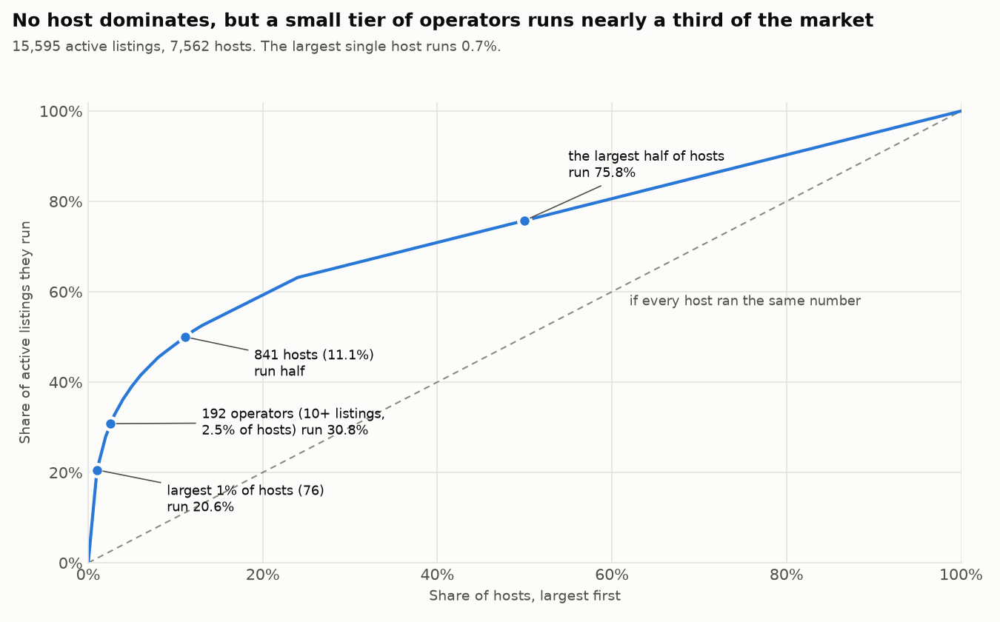
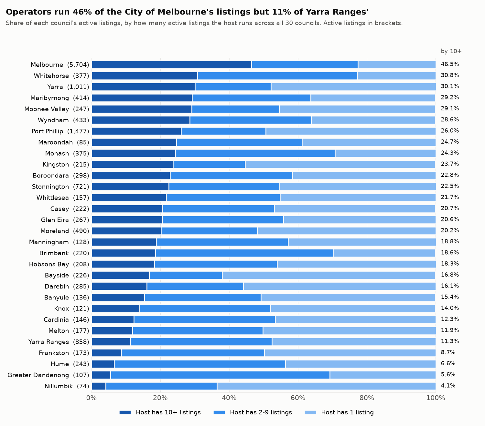
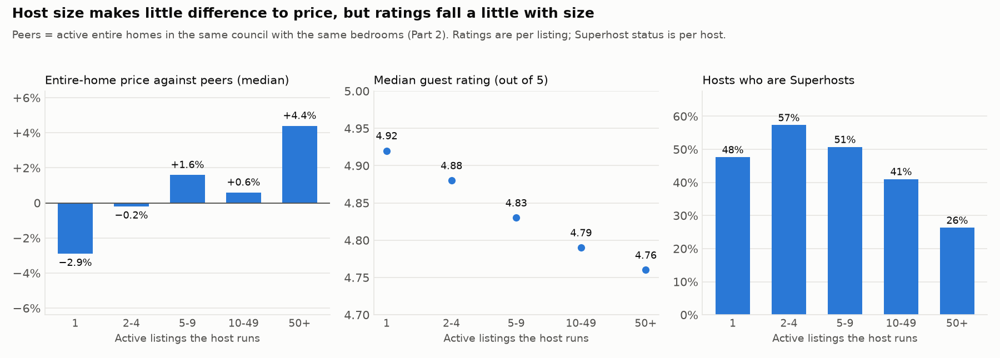

# Part 3: who runs the market

*Written by `scripts/hosts_report.py` from Inside Airbnb's Melbourne snapshot of 2026-09-16. Every
number below is read from the query results. No host is named and no per-host row is published.*

## What is counted

- **A host is one Airbnb account.** A management company may run several accounts, and one account may manage
  homes for many owners, so this measures who *runs* listings, not who owns the homes.
- **A host's size is its number of active listings** (reviewed in the 12 months to the scrape; Part 1) across all
  30 councils, counted from `host_id`. **Operators** are hosts with 10 or more; a host with 12 listings
  spread across Melbourne counts as an operator in every council it is in.
- **Why the numbers differ from Inside Airbnb's own.** Its `calculated_host_listings_count` counts every listing in
  the snapshot, dormant ones included. Counted that way there are 266 hosts with 10 or more listings, not
  192, and 13,999 hosts in all, not 7,562:

| Host has | Hosts, counting active listings (used here) | Hosts, counting all listings in the snapshot |
| --- | ---: | ---: |
| 1 listing | 5,748 | 11,225 |
| 2-4 listings | 1,352 | 2,132 |
| 5-9 listings | 270 | 376 |
| 10-49 listings | 173 | 239 |
| 50+ listings | 19 | 27 |

## Across Melbourne: no dominant host, but a tier of operators

| Market | Hosts | Listings | Per host | HHI (0-10,000) | Equal-sized hosts it equals | Hosts running half | As % of hosts | Run by operators % | Run by one-listing hosts % |
| --- | ---: | ---: | ---: | ---: | ---: | ---: | ---: | ---: | ---: |
| All active listings | 7,562 | 15,595 | 2.06 | 8.9 | 1,128 | 841 | 11.1 | 30.8 | 36.9 |
| Active entire homes | 6,203 | 12,842 | 2.07 | 11.9 | 838 | 600 | 9.7 | 34.1 | 36.9 |

| Largest hosts | Share of hosts % | Active listings they run | Share of active listings % | Share of active entire homes % (ranked by entire homes) |
| ---: | ---: | ---: | ---: | ---: |
| 1 | 0.01 | 115 | 0.7 | 0.9 |
| 10 | 0.13 | 841 | 5.4 | 6.5 |
| 50 | 0.66 | 2,551 | 16.4 | 19.5 |
| 100 | 1.32 | 3,664 | 23.5 | 27.6 |
| 500 | 6.61 | 6,667 | 42.8 | 47.7 |
| 1,000 | 13.22 | 8,219 | 52.7 | 57.0 |

- **No single host is big.** The largest runs 115 active listings
  (0.7% of the market) and the largest 10 run 5.4%. The
  Herfindahl-Hirschman index (HHI, the sum of squared market shares) is 8.9 out of 10,000: as
  concentrated as a market of 1,128 equal-sized hosts.
- **But the market is not just households letting a spare home.** The largest 1% of hosts
  (76) run 20.6% of active listings, the 192
  operators run 30.8% (and 34.1% of entire homes), and
  841 hosts (11.1% of them) run half. The other half is spread
  over 6,721 hosts, 5,748 of whom have a single listing.

**So what:** anyone who needs to reach short-stay hosts (a council enforcing local rules, a platform, a cleaning or
linen supplier selling to them) can cover nearly a third of the market through 192
accounts, but no single operator sets prices or supply. The other two-thirds can only be reached one host at a time.

## Council by council

The mix differs far more between councils than the market-wide figures suggest:

- **The City of Melbourne** has the highest operator share: operators run 46.5% of its
  5,704 active listings (48.7% of its entire homes), and
  160 of the 192 operators have a listing there. 164
  hosts run half of its listings. Only 22.6% belong to a host with no other listing.
- **7 of the 30 councils** have a quarter or more of their listings run by operators.
- **Yarra Ranges**, the 4th largest council by listings, is the opposite: operators run 11.3%,
  and hosts with fewer than 10 listings 88.7%. The lowest operator share is in
  Nillumbik (4.1% of 74 listings).
- **No council has a dominant host either.** The highest council HHI is 237 out of 10,000
  (Maroondah, 85 listings). In small councils the top 10 hosts naturally hold a
  bigger share, so the top-10 column is best compared between councils of similar size.

| Council | Active listings | Hosts | 1 listing % | 2-9 % | 10+ % | Operators present | Entire homes run by 10+ % | One-listing hosts' entire homes | Hosts running half | Top 10 hosts % | HHI |
| --- | ---: | ---: | ---: | ---: | ---: | ---: | ---: | ---: | ---: | ---: | ---: |
| Melbourne | 5,704 | 2,070 | 22.6 | 30.9 | 46.5 | 160 | 48.7 | 1,097 | 164 | 11.2 | 29 |
| Whitehorse | 377 | 199 | 22.8 | 46.4 | 30.8 | 33 | 38.6 | 64 | 43 | 20.4 | 92 |
| Yarra | 1,011 | 673 | 48.0 | 22.0 | 30.1 | 65 | 29.8 | 437 | 168 | 13.0 | 37 |
| Maribyrnong | 414 | 246 | 36.2 | 34.5 | 29.2 | 28 | 26.4 | 103 | 48 | 24.9 | 110 |
| Moonee Valley | 247 | 175 | 45.3 | 25.5 | 29.1 | 33 | 26.3 | 97 | 52 | 23.9 | 120 |
| Wyndham | 433 | 259 | 36.0 | 35.3 | 28.6 | 28 | 37.0 | 93 | 58 | 22.6 | 91 |
| Port Phillip | 1,477 | 988 | 49.4 | 24.6 | 26.0 | 72 | 28.5 | 642 | 250 | 12.7 | 30 |
| Maroondah | 85 | 59 | 38.8 | 36.5 | 24.7 | 11 | 26.5 | 28 | 17 | 35.3 | 237 |
| Monash | 375 | 211 | 29.3 | 46.4 | 24.3 | 31 | 35.0 | 84 | 47 | 21.1 | 99 |
| Kingston | 215 | 166 | 55.3 | 20.9 | 23.7 | 19 | 25.1 | 95 | 59 | 22.3 | 126 |
| Boroondara | 298 | 210 | 41.6 | 35.6 | 22.8 | 33 | 27.4 | 93 | 61 | 20.1 | 81 |
| Stonnington | 721 | 496 | 45.4 | 32.2 | 22.5 | 55 | 25.6 | 285 | 136 | 11.5 | 37 |
| Whittlesea | 157 | 109 | 45.2 | 33.1 | 21.7 | 12 | 17.2 | 42 | 31 | 30.6 | 185 |
| Casey | 222 | 159 | 46.8 | 32.4 | 20.7 | 19 | 29.7 | 73 | 48 | 18.5 | 90 |
| Glen Eira | 267 | 189 | 44.2 | 35.2 | 20.6 | 24 | 27.4 | 91 | 56 | 21.0 | 101 |
| Moreland | 490 | 349 | 51.8 | 28.0 | 20.2 | 30 | 17.9 | 202 | 104 | 17.8 | 73 |
| Manningham | 128 | 96 | 43.0 | 38.3 | 18.8 | 15 | 23.8 | 46 | 32 | 23.4 | 132 |
| Brimbank | 220 | 118 | 29.5 | 51.8 | 18.6 | 13 | 17.2 | 48 | 27 | 26.4 | 140 |
| Hobsons Bay | 208 | 146 | 46.2 | 35.6 | 18.3 | 17 | 23.7 | 70 | 42 | 23.6 | 138 |
| Bayside | 226 | 184 | 61.9 | 21.2 | 16.8 | 13 | 19.7 | 115 | 71 | 20.4 | 132 |
| Darebin | 285 | 220 | 55.8 | 28.1 | 16.1 | 24 | 20.7 | 124 | 78 | 19.6 | 78 |
| Banyule | 136 | 105 | 50.7 | 33.8 | 15.4 | 16 | 18.9 | 55 | 37 | 25.7 | 138 |
| Knox | 121 | 88 | 47.9 | 38.0 | 14.0 | 12 | 21.3 | 49 | 28 | 30.6 | 169 |
| Cardinia | 146 | 107 | 46.6 | 41.1 | 12.3 | 10 | 15.3 | 59 | 34 | 22.6 | 125 |
| Melton | 177 | 130 | 50.3 | 37.9 | 11.9 | 11 | 16.8 | 53 | 42 | 19.8 | 104 |
| Yarra Ranges | 858 | 562 | 47.6 | 41.1 | 11.3 | 16 | 11.6 | 391 | 133 | 12.8 | 45 |
| Frankston | 173 | 131 | 49.7 | 41.6 | 8.7 | 11 | 10.9 | 76 | 45 | 20.2 | 102 |
| Hume | 243 | 166 | 43.6 | 49.8 | 6.6 | 9 | 9.0 | 73 | 45 | 18.1 | 87 |
| Greater Dandenong | 107 | 68 | 30.8 | 63.6 | 5.6 | 5 | 11.5 | 17 | 20 | 31.8 | 197 |
| Nillumbik | 74 | 64 | 63.5 | 32.4 | 4.1 | 3 | 4.5 | 41 | 27 | 27.0 | 175 |

Sorted by the 10+ column. Host size is counted across all 30 councils.

**So what:** in the City of Melbourne, short-stay supply is largely a professional business, so rules on
registration, building by-laws or caps would mostly land on a few hundred operators. In outer and hills councils
supply is mostly hosts with one or a few listings, where the same rules reach many more people per listing.
A council housing team should read its own row, not the Melbourne-wide average.

### The one-listing owner market

For a property manager, the entire homes run by a host with no other active listing are the obvious clients:
there are 4,743 across the 30 councils, and 2,852 of them are in five councils:
Melbourne (1,097), Port Phillip (642), Yarra (437), Yarra Ranges (391), Stonnington (285).
Relative to size, the pool is much bigger outside the City of Melbourne: one-listing hosts run
48.7% of Yarra Ranges' entire homes against
21.2% of the City of Melbourne's, where operators
already run 48.7%.

## Operators against everyone else

| Host has | Hosts | Active listings | Share % | Entire homes % | Entire-home median $ | Against peers % | 50%+ above peers % | Reviews, 12 m | Open of next 30 | Rating | Superhosts % | Min. stay 28+ % | Councils per host |
| --- | ---: | ---: | ---: | ---: | ---: | ---: | ---: | ---: | ---: | ---: | ---: | ---: | ---: |
| 1 listing | 5,748 | 5,748 | 36.9 | 82.5 | 285 | -2.9 | 11.2 | 10.0 | 11.0 | 4.92 | 47.6 | 1.0 | 1.0 |
| 2-4 listings | 1,352 | 3,332 | 21.4 | 72.1 | 295 | -0.2 | 10.0 | 8.0 | 13.0 | 4.88 | 57.3 | 0.8 | 1.0 |
| 5-9 listings | 270 | 1,716 | 11.0 | 76.9 | 310 | 1.6 | 10.1 | 9.0 | 14.0 | 4.83 | 50.7 | 0.8 | 1.0 |
| 10-49 listings | 173 | 3,465 | 22.2 | 89.6 | 311 | 0.6 | 8.6 | 9.0 | 12.0 | 4.79 | 41.0 | 0.5 | 3.0 |
| 50+ listings | 19 | 1,334 | 8.6 | 95.6 | 312 | 4.4 | 10.6 | 10.0 | 12.0 | 4.76 | 26.3 | 0.4 | 6.0 |

Price against peers uses Part 2's comparison (priced active entire homes against the median for the same council
and bedrooms); "Open of next 30" is for the same homes.

- **Operators run entire homes:** 89.6% of listings for hosts with 10-49 and
  95.6% for 50+, against 82.5% for one-listing hosts.
- **Size makes little difference to price.** Size for size, every group's median is within
  5% of its peers: one-listing hosts quote −2.9% and hosts
  with 50+ listings +4.4%. About one home in ten sits 50% or more
  above its peers in every group (8.6% to 11.2%).
- **Demand looks much the same.** Median reviews in the year range from 8 to
  10 across the five groups (10 for one-listing hosts,
  10 for 50+), and median open nights in the next 30 days from
  11 to 14.
- **Guests rate them a little lower.** The median rating falls from 4.92 for one-listing hosts
  to 4.76 for 50+, falling with every step in size. 47.6% of one-listing
  hosts are Superhosts against 26.3% of hosts with 50+ listings; hosts with 2-4 listings are the most
  likely (57.3%).
- **Long-stay-only listings are rare in every group** (0.4% to
  1.0% need 28 nights or more), so minimum stays do not set operators apart.

**So what:** scale does not seem to buy pricing power or more bookings here, and it comes with slightly lower
guest ratings. A manager growing a portfolio should watch ratings, and an owner choosing a manager can ask to see
them.

## The typical operator

| Operators with | Hosts | Median listings | Median councils | Only entire homes % | 75%+ in one council % | Any in the inner three % | Price against peers % | Superhosts % |
| --- | ---: | ---: | ---: | ---: | ---: | ---: | ---: | ---: |
| 10-49 listings | 173 | 16.0 | 3.0 | 76.3 | 47.4 | 88.4 | -0.1 | 41.0 |
| 50+ listings | 19 | 60.0 | 6.0 | 94.7 | 36.8 | 100 | 1.0 | 26.3 |
| All operators (10+) | 192 | 17.0 | 3.0 | 78.1 | 46.4 | 89.6 | 0.0 | 39.6 |

| Listings spread over | Operators | Active listings | Median listings | Entire homes % | Median share in main council % | In the inner three % |
| --- | ---: | ---: | ---: | ---: | ---: | ---: |
| 1 council | 57 | 1,190 | 15.0 | 89.3 | 100 | 87.6 |
| 2-3 councils | 46 | 1,048 | 14.5 | 82.4 | 82.5 | 78.0 |
| 4-9 councils | 71 | 1,827 | 18.0 | 94.0 | 50.0 | 63.1 |
| 10+ councils | 18 | 734 | 31.5 | 99.9 | 32.7 | 44.4 |

The median operator runs 17 active listings across 3 councils;
78.1% run nothing but entire homes, and 89.6% have at least one
listing in the City of Melbourne, Port Phillip or Yarra. 46.4% keep three-quarters or
more of their listings in one council. 57 operators are in a single council
(87.6% of their listings in the inner three), while 18 spread over
10 or more councils, with a median 31.5 listings each. Across operators, the median of
their homes' price against peers is 0.0%.

**So what:** the typical operator is an entire-home business of one or two dozen listings with a foot in the inner
city, often reaching into other councils. That is the competitor a new property manager meets there.

## Limits

- Accounts are not companies or owners: one business may use several accounts, and a manager's account mixes
  homes from many owners. Concentration by owner cannot be measured from this data.
- Host size counts active listings only. A host's dormant or unreviewed listings, and listings outside the 30
  councils in this snapshot, are not counted.
- `host_since` is empty in this snapshot (Part 1), so how long hosts have operated cannot be analysed.
- Ratings cluster near 5, so small differences in the median are real differences in the data but small ones.
- Price comparisons use one quoted stay per listing (Part 2's limits apply).
