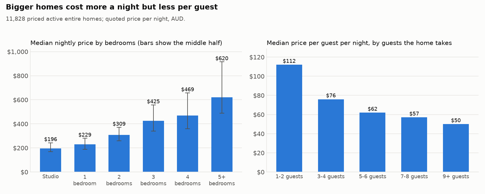
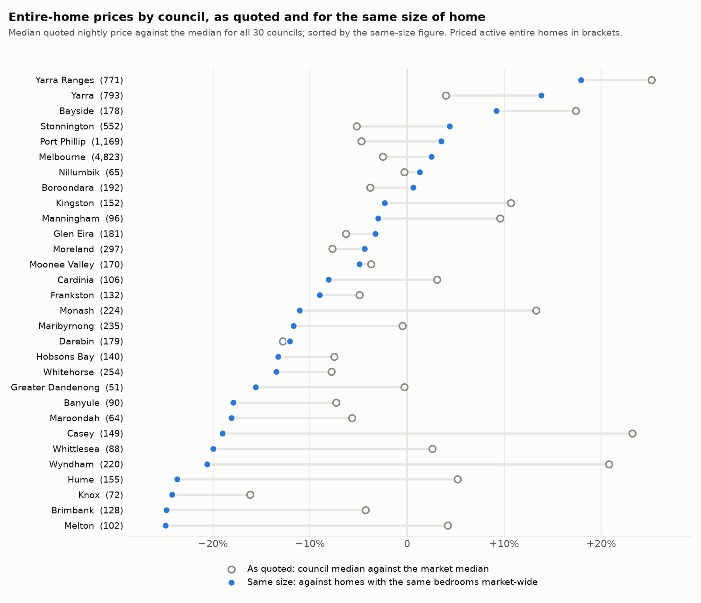
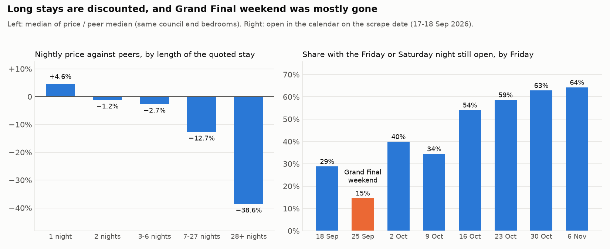
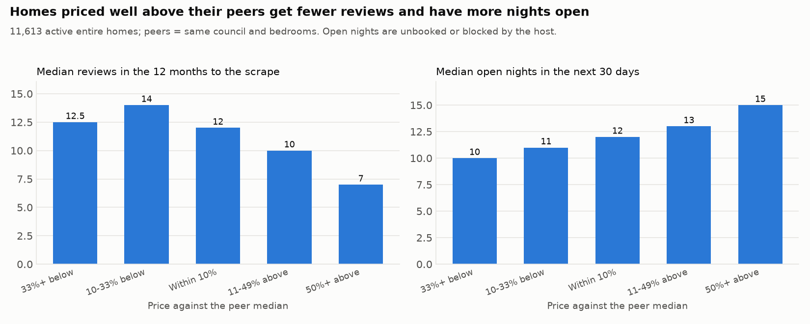

# Part 2: what a night costs

*Written by `scripts/pricing_report.py` from Inside Airbnb's Melbourne snapshot of 2026-09-16. Every
number below is read from the query results.*

## What is compared

This part looks at **active entire homes and apartments** (the 12,842 reviewed in the 12 months to the
scrape; Part 1 defines "active"), because they are 12,842 of the 15,595 active listings and the kind a
property manager runs or an investor buys. 11,841 have a quoted price and 11,828 of those a
bedroom count (13 have none and are left out).

Two things about the price matter for everything below (Part 1, check 5):

- **It is a quote, not a list price.** `price` is the average nightly price of a real quoted stay: usually the
  listing's minimum stay, starting on its next open night. So each listing has one price, for one set of dates.
- **The calendar has no prices.** It says which nights are open, not what they cost, so price cannot be followed
  through the year for one listing; differences by date are differences between listings.

**Peers.** A listing's peers are the active entire homes in the same council with the same number of bedrooms
(studio, 1, 2, 3, 4, 5 or more). Each listing's price is divided by its peer group's median (the group includes
the listing itself). Groups with fewer than 10 listings are not scored: 128 of
175 groups are large enough, and they hold 11,613 of the 11,828 homes
(98.2%). Medians throughout, so a few extreme quotes barely move the results.

## Size: price per night rises, price per guest falls

| Size | Listings | 25th pct $ | Median $ | 75th pct $ | Median guests | Per guest $ |
| --- | ---: | ---: | ---: | ---: | ---: | ---: |
| Studio | 276 | 170 | 196 | 243 | 2.0 | 89 |
| 1 bedroom | 3,932 | 188 | 229 | 280 | 2.0 | 100 |
| 2 bedrooms | 4,634 | 259 | 309 | 371 | 4.0 | 71 |
| 3 bedrooms | 1,827 | 340 | 425 | 557 | 6.0 | 67 |
| 4 bedrooms | 816 | 360 | 469 | 657 | 8.0 | 58 |
| 5+ bedrooms | 343 | 488 | 620 | 915 | 12.0 | 54 |

A 2-bedroom home's median quote is $309 a night against $229
for 1 bedroom, and a 3-bedroom's is $425. Per guest it runs the other way: from
$112 a night for homes taking 1-2 guests to $50
for homes taking 9 or more.

| Takes | Listings | Median $ | Per guest $ |
| --- | ---: | ---: | ---: |
| 1-2 guests | 3,076 | 223 | 112 |
| 3-4 guests | 4,273 | 290 | 76 |
| 5-6 guests | 2,694 | 350 | 62 |
| 7-8 guests | 1,033 | 440 | 57 |
| 9+ guests | 752 | 530 | 50 |

**So what:** per head, a large home is the cheapest way to stay, so large homes compete for groups and families,
and a host pricing a large home per guest like a 1-bedroom would sit far above the market. Bedrooms, not guests, are used for peer groups below, because a host
can change the guest limit but not the floor plan.

## Councils: the raw median misleads

The market median for a priced active entire home is $300. Ranked by their own medians,
outer-suburban councils look expensive: Wyndham is 20.8% above the
market and ranks 3 of 30. But its homes are bigger: its median
entire home has 4 bedrooms, against 2 in 22 of the
30 councils. Compared with homes of the same size, the order changes:

- **Down the ranking:** Wyndham 3 → 26, Casey 2 → 24, Melton 9 → 30, Hume 8 → 27. For
  the same number of bedrooms they price 20.6% below, 19.0% below, 24.9% below, 23.7% below the market.
- **Up the ranking:** Stonnington 22 → 4, Port Phillip 20 → 5. Their
  homes are smaller (49.8% and 47.0% studios or 1-bedrooms, against
  35.6% market-wide), which hides that size for size they price
  4.4% above, 3.5% above the market.
- **Top and bottom, size for size:** Yarra Ranges (17.9% above; the Yarra Valley and the
  Dandenongs) and Melton (24.9% below). 8 of the
  30 councils price above the market for their size.

"Same size" is the median, across a council's homes, of price ÷ the market median for the same bedrooms. The
2-bedroom median is a check that needs no adjustment: across the 18 councils with 30 or
more 2-bedroom homes, it ranks councils much as the same-size figure does (rank correlation 0.81) and
quite unlike the raw median (0.31).

| Council | Listings | Median $ | Studio or 1-bed % | As quoted vs market % | Rank as quoted | Same size vs market % | Rank, same size | 2-bedroom median $ |
| --- | ---: | ---: | ---: | ---: | ---: | ---: | ---: | ---: |
| Yarra Ranges | 771 | 376 | 40.7 | 25.2 | 1 | 17.9 | 1 | 353 |
| Yarra | 793 | 312 | 47.9 | 4.0 | 10 | 13.8 | 2 | 352 |
| Bayside | 178 | 352 | 30.9 | 17.4 | 4 | 9.2 | 3 | 316 |
| Stonnington | 552 | 284 | 49.8 | -5.2 | 22 | 4.4 | 4 | 322 |
| Port Phillip | 1,169 | 286 | 47.0 | -4.7 | 20 | 3.5 | 5 | 320 |
| Melbourne | 4,823 | 292 | 35.5 | -2.5 | 16 | 2.5 | 6 | 310 |
| Nillumbik | 65 | 299 | 40.0 | -0.3 | 13 | 1.3 | 7 | 312 |
| Boroondara | 192 | 289 | 30.7 | -3.8 | 18 | 0.6 | 8 | 290 |
| Kingston | 152 | 332 | 23.7 | 10.7 | 6 | -2.3 | 9 | 300 |
| Manningham | 96 | 329 | 18.8 | 9.6 | 7 | -3.0 | 10 | 263 |
| Glen Eira | 181 | 281 | 34.8 | -6.3 | 24 | -3.3 | 11 | 292 |
| Moreland | 297 | 277 | 40.1 | -7.7 | 27 | -4.4 | 12 | 304 |
| Moonee Valley | 170 | 289 | 31.8 | -3.7 | 17 | -4.9 | 13 | 315 |
| Cardinia | 106 | 309 | 31.1 | 3.1 | 11 | -8.1 | 14 | 281 |
| Frankston | 132 | 285 | 32.6 | -4.9 | 21 | -9.0 | 15 | 269 |
| Monash | 224 | 340 | 17.4 | 13.3 | 5 | -11.1 | 16 | 303 |
| Maribyrnong | 235 | 299 | 23.4 | -0.5 | 15 | -11.7 | 17 | 276 |
| Darebin | 179 | 262 | 43.0 | -12.8 | 29 | -12.1 | 18 | 309 |
| Hobsons Bay | 140 | 278 | 32.1 | -7.5 | 26 | -13.3 | 19 | 269 |
| Whitehorse | 254 | 277 | 26.4 | -7.8 | 28 | -13.5 | 20 | 271 |
| Greater Dandenong | 51 | 299 | 15.7 | -0.3 | 13 | -15.6 | 21 | 274 |
| Banyule | 90 | 278 | 28.9 | -7.3 | 25 | -17.9 | 22 | 296 |
| Maroondah | 64 | 283 | 29.7 | -5.7 | 23 | -18.1 | 23 | 284 |
| Casey | 149 | 370 | 9.4 | 23.2 | 2 | -19.0 | 24 | 270 |
| Whittlesea | 88 | 308 | 15.9 | 2.6 | 12 | -20.0 | 25 | 243 |
| Wyndham | 220 | 362 | 10.0 | 20.8 | 3 | -20.6 | 26 | 227 |
| Hume | 155 | 316 | 12.9 | 5.2 | 8 | -23.7 | 27 | 245 |
| Knox | 72 | 251 | 33.3 | -16.2 | 30 | -24.2 | 28 | 205 |
| Brimbank | 128 | 287 | 22.7 | -4.3 | 19 | -24.8 | 29 | 267 |
| Melton | 102 | 313 | 12.7 | 4.2 | 9 | -24.9 | 30 | 205 |

**So what:** a council's median nightly rate says more about its housing stock than about what guests will pay.
An investor comparing suburbs, or a council comparing itself with its neighbours, should compare like with like:
the peer price guide below, or the same-size column.

### A price guide by council and size

`results/peer_price_guide.csv` gives the 25th percentile, median and 75th percentile quote for each of the
128 council × size groups with 10 or more active entire homes. For the three inner councils:

| Size | Melbourne | Port Phillip | Yarra |
| --- | ---: | ---: | ---: |
| Studio | 200 | 180 | 194 |
| 1 bedroom | 236 | 226 | 247 |
| 2 bedrooms | 310 | 320 | 352 |
| 3 bedrooms | 490 | 507 | 568 |
| 4 bedrooms | 758 | 704 | 728 |
| 5+ bedrooms | 901 |  |  |

Median quote, $ a night; a blank means fewer than 10 active entire homes of that size.

A 2-bedroom home in the City of Melbourne quotes $310 at the median, and the middle half
of them quote $264 to $365.

## Timing: long stays are cheaper a night, big weekends dearer

| Quoted stay | Listings | Median $ | Against peers % |
| --- | ---: | ---: | ---: |
| 1 night | 3,890 | 306 | 4.6 |
| 2 nights | 5,175 | 298 | -1.2 |
| 3-6 nights | 2,028 | 291 | -2.7 |
| 7-27 nights | 415 | 268 | -12.7 |
| 28+ nights | 105 | 174 | -38.6 |

Against their peers, homes quoting a 1-night stay price +4.6% and 2-6 nights close to
the median, but week-plus quotes are 12.7% below and stays of 28 nights or more
38.6% below, in line with the weekly and monthly discounts hosts can set. Those are
105 listings, so a small part of the market, but they are the most like a long-term rental
and come up again in Part 4.

**Weekends and Grand Final weekend.** For short quoted stays (1-3 nights) starting in the 60 days after the scrape
(9,879 homes):

| The quoted stay | Listings | Median $ | Against peers % |
| --- | ---: | ---: | ---: |
| Includes 25 or 26 Sep (Grand Final eve and day) | 219 | 380 | 26.4 |
| Includes a Friday or Saturday night (other weeks) | 3,464 | 317 | 4.7 |
| Sunday to Thursday nights only | 6,196 | 290 | -2.4 |

Stays covering a Friday or Saturday night quote +4.7% against peers, and Sunday to
Thursday stays −2.4%. Stays covering the night of Friday 25 or Saturday 26 September 2026
quote +26.4%. That was the AFL Grand Final weekend: the match was at the MCG on
Saturday 26 September, and Friday 25 September was Victoria's Grand Final eve public holiday
([City of Melbourne](https://whatson.melbourne.vic.gov.au/footy-in-the-city);
[Premier of Victoria](https://www.premier.vic.gov.au/footy-festival-starts-countdown-historic-grand-final)).

The calendar shows how much of that weekend was already gone a week before:

| Weekend | Friday or Saturday open | Share % |
| --- | ---: | ---: |
| Fri 18 Sep | 3,339 | 28.8 |
| Fri 25 Sep (Grand Final) | 1,694 | 14.6 |
| Fri 2 Oct | 4,634 | 39.9 |
| Fri 9 Oct | 3,997 | 34.4 |
| Fri 16 Oct | 6,269 | 54.0 |
| Fri 23 Oct | 6,810 | 58.6 |
| Fri 30 Oct | 7,298 | 62.8 |
| Fri 6 Nov | 7,459 | 64.2 |

Only 14.6% of scored homes still had the Friday or the Saturday open, against 28.8%
for the weekend the scrape finished on (Friday 18 September) and 39.9% the weekend after the Grand Final;
from late October about 64% are still open. The calendar cannot separate a booked night from a
blocked one, so this is "not available", not "booked".

Two cautions on the +26.4%. It compares different listings: each home has one quote,
and the 219 homes whose next stay fell on that weekend are those still open then, not the
same homes priced on another date. And their peers are measured on whatever dates their own quotes fell. It is
consistent with event pricing, not a measure of it.

**How far ahead the stay starts makes little difference.** Grouped by days from the scrape to the quoted check-in,
the median against peers stays between −2.9% and +5.0%, with no steady last-minute discount
or early-booking premium:

| Stay starts in | Listings | Median $ | Against peers % |
| --- | ---: | ---: | ---: |
| 0-1 days | 2,697 | 312 | 2.8 |
| 2-6 days | 3,737 | 298 | -2.8 |
| 7-13 days | 1,867 | 300 | 4.1 |
| 14-29 days | 1,665 | 288 | -2.3 |
| 30-89 days | 1,142 | 279 | -2.9 |
| 90+ days | 505 | 314 | 5.0 |

**So what:** for a property manager the clear levers are length of stay (monthly guests take a large discount) and
peak events, where most homes are taken well ahead: a host whose home was still open for Grand Final weekend a
week before had few competing homes left on the calendar.

## Listings priced well above or below their peers

| Price against peers | Listings | Share % | Median $ | Median guests | Reviews, 12 m (median) | Reviews, 12 m (mean) | Open of next 30 | Open of next 90 | Rating |
| --- | ---: | ---: | ---: | ---: | ---: | ---: | ---: | ---: | ---: |
| A third or more below | 906 | 7.8 | 177 | 4.0 | 12.5 | 19.5 | 10.0 | 48.0 | 4.80 |
| 10-33% below | 3,180 | 27.4 | 238 | 4.0 | 14.0 | 20.1 | 11.0 | 51.0 | 4.84 |
| Within 10% | 3,473 | 29.9 | 300 | 4.0 | 12.0 | 17.4 | 12.0 | 55.0 | 4.86 |
| 11-49% above | 2,876 | 24.8 | 369 | 4.0 | 10.0 | 14.7 | 13.0 | 58.0 | 4.88 |
| 50% or more above | 1,178 | 10.1 | 535 | 4.0 | 7.0 | 12.5 | 15.0 | 61.0 | 4.92 |

Bands are symmetric on a ratio scale ("within 10%" is 0.9 to 1.11 times the peer median; "50% or more above" is
1.5 times or more and "a third or more below" is 1 ÷ 1.5 or less). 10.1% of scored homes price 50% or
more above their peers and 7.8% a third or more below.

- **Homes priced well above their peers get fewer reviews.** The median for homes 50% or more above is
  7 reviews in the year against 12 for homes within
  10% (58% as many), and they have 15 of the next 30 nights open against
  12. A review needs a completed stay, so fewer reviews means fewer stays, unless
  guests of dearer homes review less often, which this data cannot show.
- **It is not just bigger homes.** Peers already share a council and bedroom count, and the median guest limit is
  4 in every band.
- **They are rated a little higher** (4.92 against 4.86 at the
  median), so part of the gap is likely quality the bedroom count does not capture: views, fit-out, location within
  the council.
- **Cheap homes are only a little busier.** Homes a third or more below their peers have about the same median
  reviews as those near the median (12.5 against 12)
  and slightly fewer open nights (10 of the next 30 against
  12). Pricing far below peers goes with only a small gain on either measure.

**So what:** of the 2,084 homes in the two outer bands, the dear ones show fewer stays and more open nights, and
the cheap ones only slightly the reverse. For a property manager taking on a new home, the peer median is the starting price, and a
quote 50% above it needs the quality to back it. Whether the dearer homes still earn more over the year (a higher
price on fewer nights) is Part 4's question, which estimates earnings.

## Limits

- One quote per listing, for its next open stay, so price differences by date are differences between listings.
- Peers share a council and bedroom count, not a street, view or fit-out; a council is a large area.
- Reviews stand in for stays, and open calendar nights mix unbooked with blocked nights.
- The Grand Final dates come from the City of Melbourne and the Premier's office, cited above; the scrape was about a
  week before, so the calendar shows bookings as of then, not the final take-up.
