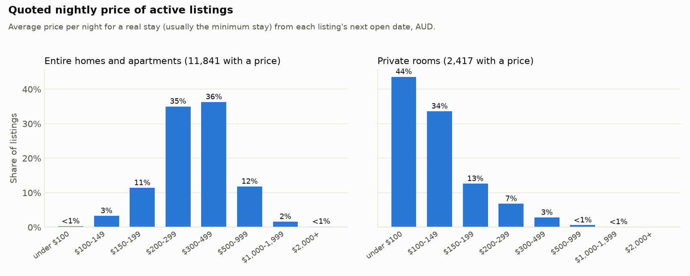
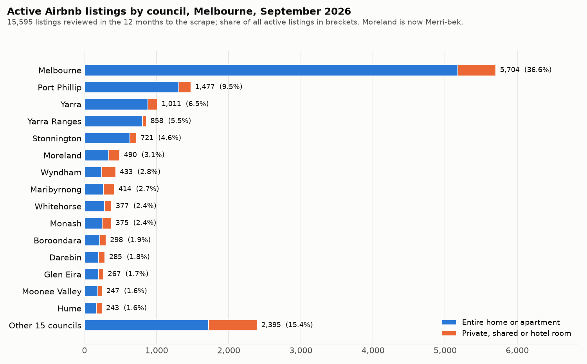
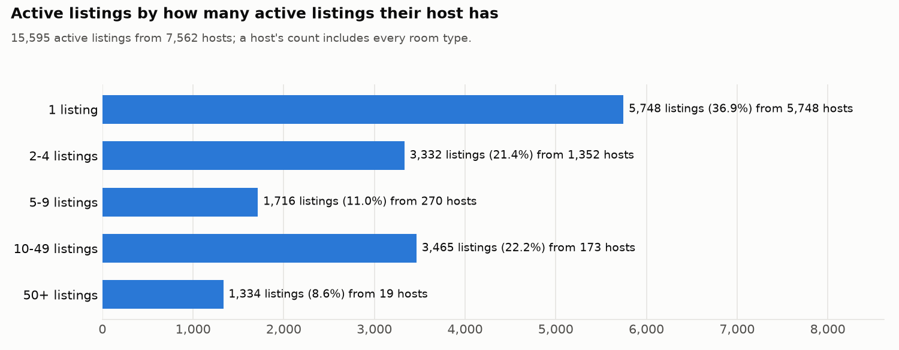
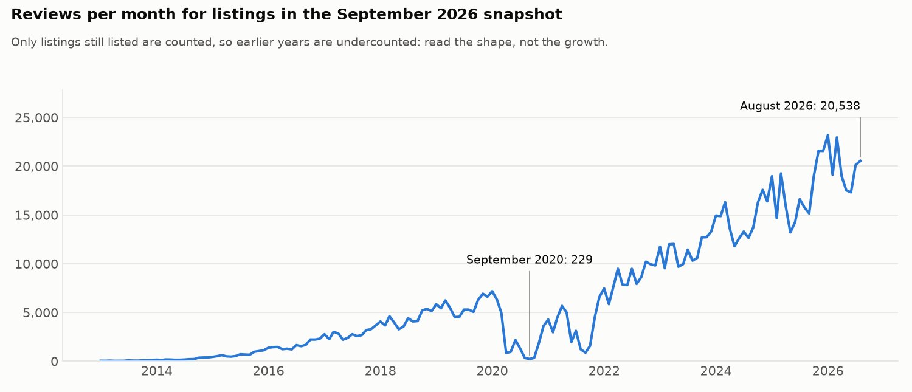

# Part 1: the snapshot and what is in it

*Written by `scripts/profile_report.py` from Inside Airbnb's Melbourne snapshot of 2026-09-16
(scraped 2026-09-17 to 2026-09-18). Every number below is read from the query results.*

## The data

Inside Airbnb collects public Airbnb listing pages for Melbourne each quarter and publishes them under
CC BY 4.0. Four files are used (SHA-256 pinned in `str_market/source.py`, details in `data/SNAPSHOT.json`):

| File | Rows | What it holds |
| --- | ---: | --- |
| `listings.csv.gz` | 25,715 | one row per listing: host, council, room type, quoted price, minimum stay, availability, review counts |
| `calendar.csv.gz` | 9,385,976 | one row per listing per day, 2026-09-17 to 2027-09-17: open for booking or not |
| `reviews.csv` | 1,042,226 | the listing and date of every review, 2010-08-04 to 2026-09-18 |
| `neighbourhoods.geojson` | 30 | the council (LGA) boundaries listings are assigned to |

Inside Airbnb asks users not to republish its data, so no listing-level row is committed here: the raw files
are downloaded once into `data/raw/` (gitignored) and only aggregates are published. Host names, profile text,
descriptions and photos are dropped when the data is loaded, and no result names a host.

## Which listings count

The snapshot holds 25,715 listings from 13,999 hosts, but how big "the market" is depends
on which of them count:

| Which listings | Listings | Hosts |
| --- | ---: | ---: |
| All listings in the snapshot | 25,715 | 13,999 |
| Found in this scrape (not carried over from an earlier one) | 18,872 | 8,975 |
| With a quoted price | 19,004 | 9,055 |
| At least one open night in the next 365 days | 19,532 | 9,364 |
| Reviewed in the last 12 months (the active market used here) | 15,595 | 7,562 |
| Active and with a quoted price | 14,368 | 6,963 |

6,843 listings (26.6%) were not found in this scrape but carried over from an earlier
one. They look dormant: 6,144 of them have no open night in the next year, only 463
have a quoted price, and their median last review is March 2023 (against
August 2026 for listings found in this scrape).

**From here on the market is the 15,595 active listings: those with at least one review in the 12 months to the
scrape.** A review needs a completed stay, so this counts listings that actually take guests, and it does not
depend on the calendar, which cannot tell a booked night from one the host has blocked. It misses listings with
stays but no reviews (Inside Airbnb's own occupancy model assumes half of stays get one), so it undercounts
somewhat.

## Quality checks

20 checks in `sql/quality_checks.sql`: 14 pass, 2 find a small mismatch and 4 are counts
reported for information.

| # | Check | Found | Expected | Status |
| ---: | --- | ---: | ---: | --- |
| 1 | Duplicate listing ids | 0 | 0 | pass |
| 2 | Listings outside the 30 councils in the boundary file | 0 | 0 | pass |
| 3 | Councils with no listing | 0 | 0 | pass |
| 4 | Prices that do not parse as a number | 0 | 0 | pass |
| 5 | Price differs from the quoted total / nights | 0 | 0 | pass |
| 6 | Price quoted for a check-in before the scrape date | 0 | 0 | pass |
| 7 | Listings with no calendar | 0 | 0 | pass |
| 8 | Calendar rows for listings not in the snapshot | 0 | 0 | pass |
| 9 | Listings whose calendar is not exactly 365 days | 1 | 0 | note |
| 10 | availability_365 differs from the open days in the calendar | 12 | 0 | note |
| 11 | Reviews for listings not in the snapshot | 0 | 0 | pass |
| 12 | number_of_reviews differs from the review file | 0 | 0 | pass |
| 13 | first_review or last_review differs from the review file | 0 | 0 | pass |
| 14 | number_of_reviews_ltm differs from reviews in the 365 days to the scrape | 0 | 0 | pass |
| 15 | Host listing count differs from a count by host_id | 0 | 0 | pass |
| 16 | Reviews dated after the scrape | 0 | 0 | pass |
| 17 | Listings with no quoted price | 6,711 |  | info |
| 18 | Quoted price under $20 a night | 1 |  | info |
| 19 | Quoted price of $2,000 a night or more | 114 |  | info |
| 20 | Listings with a licence or registration number | 0 |  | info |

- **The review counts reconcile exactly.** Each listing's review count, first and last review date, and
  reviews in the last 12 months (counted from 365 days before its own scrape date, inclusive) match the review
  file, so the active definition above rests on data that agrees with itself.
- **Calendar (checks 9 and 10).** One listing has 366 calendar days and 12 listings show
  0 in `availability_365` though their calendar has open days. Later parts count open nights from the
  calendar itself.
- **Price (checks 17-19).** `price` is not a list price: it is the average nightly price of a real quoted stay
  (`quote_total` / nights, check 5). The quoted stay is the listing's minimum stay in
  83.7% of quotes (never shorter) and starts on its first open night
  in 88.1%, so prices are for the next available stay, not a
  typical night. 6,711 listings have no price, 6,380 of
  them carried-over listings; among active listings 1,227
  have none. 114 quotes are $2,000 a night or more; they are kept, and the results use
  medians and bands, which a few extreme quotes barely move.
- **Empty columns:** `host_since`, `instant_bookable`, `licence` are empty for every listing in this snapshot, so
  host tenure, instant booking and registration numbers cannot be analysed.

## Entire homes are most of the market

| Room type | Active listings | Share % | With a price | 25th pct $ | Median $ | 75th pct $ | Median guests |
| --- | ---: | ---: | ---: | ---: | ---: | ---: | ---: |
| Entire home/apt | 12,842 | 82.3 | 11,841 | 230 | 300 | 398 | 4.0 |
| Private room | 2,641 | 16.9 | 2,417 | 82 | 107 | 144 | 2.0 |
| Shared room | 99 | 0.6 | 97 | 37 | 51 | 70 | 1.0 |
| Hotel room | 13 | 0.1 | 13 | 318 | 354 | 399 | 2.0 |

82.3% of active listings are entire homes or apartments, the kind of listing that
could otherwise be a long-term rental. Their median quoted price is $300 a night
($230 to $398 for the middle half); a private room's is
$107.

71.3% of priced entire homes quote $200-499 a night, while
77.2% of private rooms quote under $150.

## Where the listings are

| Council | Active listings | Share of market % | Entire homes % | Entire home median $ |
| --- | ---: | ---: | ---: | ---: |
| Melbourne | 5,704 | 36.6 | 90.7 | 292 |
| Port Phillip | 1,477 | 9.5 | 88.8 | 286 |
| Yarra | 1,011 | 6.5 | 87.2 | 312 |
| Yarra Ranges | 858 | 5.5 | 93.6 | 375 |
| Stonnington | 721 | 4.6 | 87.2 | 284 |
| Moreland | 490 | 3.1 | 68.6 | 277 |
| Wyndham | 433 | 2.8 | 55.0 | 362 |
| Maribyrnong | 414 | 2.7 | 63.0 | 299 |
| Whitehorse | 377 | 2.4 | 74.3 | 277 |
| Monash | 375 | 2.4 | 65.6 | 340 |

The City of Melbourne alone has 5,704 active listings
(36.6% of the market); with Port Phillip and Yarra
the three inner councils have 52.5%. Outside the centre the mix changes: Yarra Ranges (the Yarra
Valley and the Dandenongs) is the fourth-largest at 858 listings, 93.6% of them
entire homes, while in Greater Dandenong only 48.6% are. Full table:
`results/by_lga.csv`.

## Minimum stays

| Minimum stay | Active listings | Share % |
| --- | ---: | ---: |
| 1 night | 7,469 | 47.9 |
| 2 nights | 5,410 | 34.7 |
| 3-6 nights | 2,119 | 13.6 |
| 7-27 nights | 462 | 3.0 |
| 28+ nights | 123 | 0.8 |
| not given | 12 | 0.1 |

82.6% of active listings take one- or two-night stays. Only
123 (0.8%) require 28 nights or more, which would make
them medium-term rentals rather than holiday lets.

## Hosts: a first look

| Host has | Hosts | Active listings | Share of listings % |
| --- | ---: | ---: | ---: |
| 1 listing | 5,748 | 5,748 | 36.9 |
| 2-4 listings | 1,352 | 3,332 | 21.4 |
| 5-9 listings | 270 | 1,716 | 11.0 |
| 10-49 listings | 173 | 3,465 | 22.2 |
| 50+ listings | 19 | 1,334 | 8.6 |

7,562 hosts run the 15,595 active listings. Hosts with a single listing have
36.9% of them; hosts with two or more have 63.1%, and the
192 hosts with 10 or more have 30.8%. Part 3 looks at this properly.

## Reviews over time

The review file counts 237,028 reviews in the 12 months from September 2025 against
67,540 in 2019 and 23,433 from April 2020 to March 2021, when lockdowns
stopped travel. **This is not market growth:** a listing that has left Airbnb takes its reviews with it, so the
further back a month is, the more of its reviews are missing. The chart is useful for seasonality and for the
size of the lockdown drop, not for the trend.

## What this means for the business

- **Define the market before sizing it.** The snapshot's 25,715 listings are
  65% more than the 15,595 active ones. Of the 10,120 that are
  not active, 5,480 are carried-over listings that look dormant and
  4,640 are listed but have had no review in a year. A council, investor or property manager
  quoting the headline count would overstate the market by about two-thirds.
- **This is an entire-home, inner-city market.** 82.3% entire homes, and
  52.5% in three councils. Any effect on housing supply would be concentrated there; Part 4
  tests how many look like homes taken off the long-term market.
- **A large share is run by multi-listing hosts.** 63.1% of active listings belong to hosts with two
  or more, and 192 hosts run 30.8%, so a small number of operators' decisions move a
  large part of the market. Part 3 measures how concentrated it is.

## Limits (so far)

- One snapshot (September 2026), so this project does not track change over time. Inside Airbnb holds older
  snapshots, which it supplies on request; none were requested.
- Activity is inferred from reviews, and the calendar cannot separate booked nights from blocked ones.
- Listing locations are moved by up to about 150 metres by Airbnb, which does not matter at council level.
- Inside Airbnb is an advocacy project as well as a data source; the numbers here are recomputed from its raw
  files with the definitions stated in `sql/`, not taken from its dashboards.
